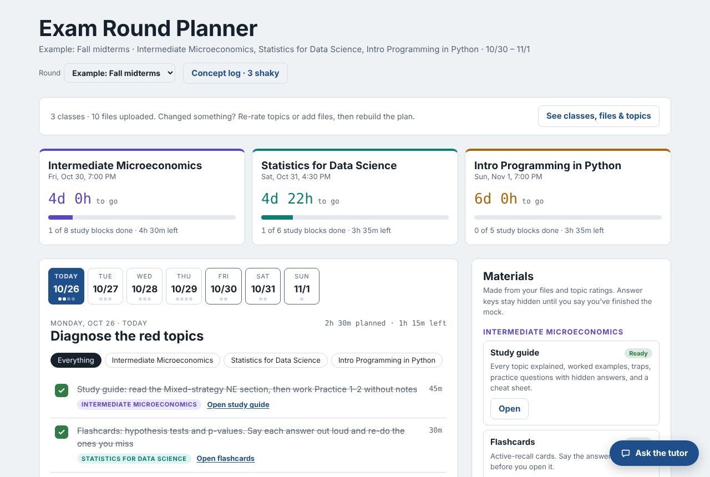
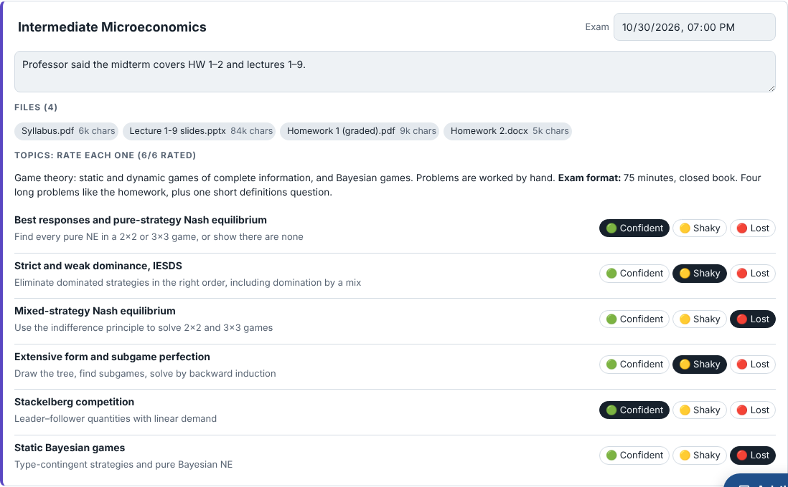
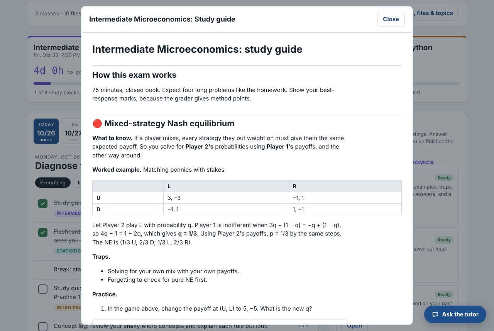
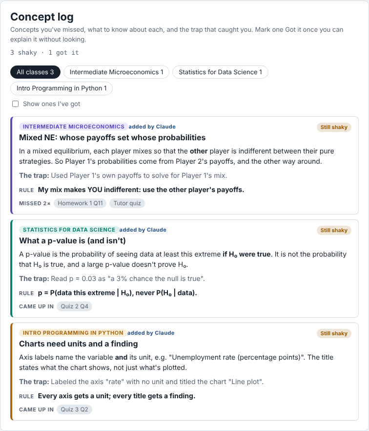
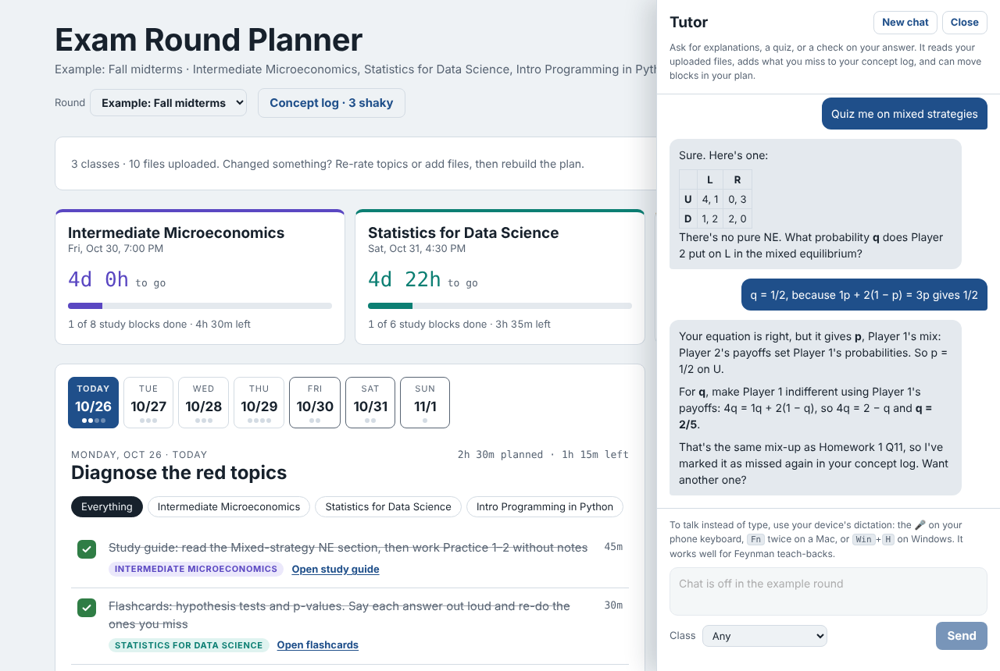

# Exam Round Planner

A study planner that anyone can use for any set of classes. It runs as a [Claude artifact](https://claude.ai), so each person signs in with their own Claude account and gets a private plan.

## Try it

**[Open the Exam Round Planner →](https://claude.ai/artifact/A2D8pjgkBdvgu7UeMyG8ua)**

- **Visitors**, for example from outside my organization: you'll need to sign in to Claude. You'll then see a read-only example round with sample classes, where you can browse the plan, open the study guides and answer keys, and look at the concept log and an example tutor chat.
- **Classmates** with Contributor access: start a round, add your classes and exam times, and upload your files. Your rounds, files and plan stay private to you. Making plans and materials uses your own Claude usage.

**Don't download `index.html` to use it.** Opened as a plain file, it can only show the example round, because sign-in, storage and Claude all come from claude.ai. To run your own independent copy, ask Claude Code to publish `exam-round-planner/index.html` as an artifact with the `db`, `user`, `sample` and `downloads` capabilities.

## Screenshots

**A day in the plan**, with exam countdowns and progress for each class:

**Classes, files and topics.** Claude finds the topics in your uploads, and you rate each one:

**Generated study guide**, with worked examples and practice answers hidden until you open them:

**Concept log.** Each concept you missed, the trap, and a rule to remember:

**Tutor.** It quizzes you, explains what went wrong, and logs the miss:

## What it does

1. **Exam rounds.** Create one round per exam period (midterms, finals). A new round can bring over your classes, files and still-shaky concepts from the last one.
2. **Classes and files.** Add each class with its exam date and time, then upload what you have: syllabus, slides, notes, homework, quizzes, past exams. It reads PDFs, Word (.docx), PowerPoint (.pptx), Jupyter notebooks, HTML, text and .zip files in the browser. Claude reads scanned PDFs and photos. You can also paste text, such as flashcard sets.
3. **Topics.** Claude reads the files, lists what the exam is likely to test, guesses the format, and picks out mistakes in graded work. You rate each topic 🟢 confident, 🟡 shaky or 🔴 lost.
4. **Plan.** A day-by-day plan from today to your last exam, sized to the hours you have. It puts more time on 🔴 and 🟡 topics, spaces out review, and schedules mock exams a few days before each exam. You check blocks off as you go, and rebuilding the plan reschedules anything unfinished.
5. **Materials.** Each class gets a study guide, flashcards, a mock exam modeled on past exams, and an answer key that stays hidden until you say you've finished the mock. Each one downloads as Markdown.
6. **Concept log.** Every concept you've missed, what to know about it, the trap that caught you, and a one-line rule.
7. **Tutor.** It explains, quizzes and checks answers, and runs Feynman teach-backs. It reads your files, logs what you miss, and can move or add blocks in your plan. You can open a material and highlight a passage to ask about it.

## Running it

`index.html` is the artifact page. It uses the claude.ai artifact runtime (`window.claude`) with the `db`, `user`, `sample` and `downloads` capabilities, so it only works when published as an artifact. It won't work as a plain local file.

Generation runs on each viewer's own Claude usage. Anyone you share it with needs at least **Contributor** access to save their own plan. Everyone's data is stored privately per user.
